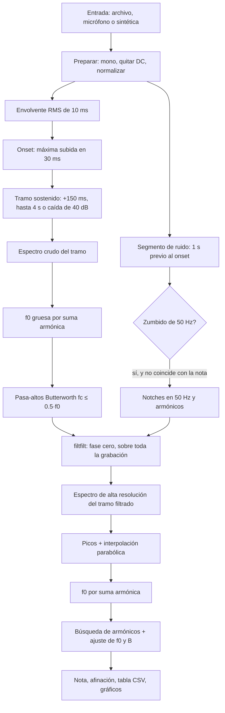

# Inarmonía de notas: documento para la defensa

Pensado para defender el trabajo en 8 minutos. Cada número de este documento sale de una prueba que corrimos. Si el tribunal pregunta algo que no está acá, la respuesta está en el código (ver el [mapa del código](#mapa-dónde-está-cada-cosa-en-el-código)).

---

## 1. El problema y la física de la inarmonía

Una cuerda ideal vibra en armónicos exactos: si la fundamental es f0, los armónicos están en 2·f0, 3·f0, 4·f0, etc. Una cuerda real **tiene rigidez**: se comporta un poco como una varilla, y la rigidez hace que los armónicos altos queden un poco **más agudos** de lo que debería.

El modelo que usamos es:

**f_k = k · f0 · √(1 + B·k²)**

- **k** es el número de armónico (1, 2, 3, ...).
- **f0** es la frecuencia fundamental "ideal".
- **B** es el **coeficiente de inarmonía**. Cuanto más grande, más se desvían los armónicos altos.

Para una cuerda rígida, B ≈ π³·E·d⁴ / (64·T·L²), donde E es el módulo de Young, d el diámetro, T la tensión y L el largo vibrante. Es decir: B crece con el **grosor** (a la cuarta potencia) y decrece con el **largo** (cuadrado). Por eso los **bajos de piano** (cuerdas gruesas y cortas) tienen B grande y los agudos tienen B casi nulo.

Por qué importa: un afinador que mide solamente f0 no ve que el piano está "estirado" en los agudos. Midiendo B y las desviaciones de cada armónico se ve la inarmonía completa.

Números de referencia que usamos para entender la escala:

| Nota | f0 | B típico | Desvío del 10.º armónico por B | En cents |
|---|---|---|---|---|
| Bajo de piano | 55 Hz | 3·10⁻⁴ | 8.2 Hz | ≈ 26 cents |
| Nota media | 110 Hz | 1·10⁻⁴ | — | — |
| La 440 | 440 Hz | 1·10⁻⁵ | 2.2 Hz | ≈ 0.9 cents |

Esto explica por qué **las notas graves son el desafío**: el efecto de B es grande, pero las notas graves tienen pocos armónicos "visibles" y la resolución en Hz es más pobre.

---

## 2. Pipeline completo

### Bloque por bloque

**Carga y preparación** (`js/audio.js`, `prepararSenal`)
- *Qué hace*: decodifica el archivo, pasa a mono promediando canales, resta la media (quita DC) y normaliza al máximo = 1.
- *Decisión*: promediar canales en lugar de usar sólo el izquierdo.
- *Por qué*: la nota suena igual en ambos canales; promediar reduce el ruido que sea distinto en cada canal.
- *Descartado*: usar sólo un canal (perdemos la mitad del ruido independiente).
- *Por qué quitar DC*: una componente continua no es parte de la nota y ensucia el espectro en 0 Hz.

**Envolvente RMS y onset** (`js/segmentacion.js`, `envolventeRMS`, `detectarOnset`)
- *Qué hace*: calcula la energía en ventanas de 10 ms (en dB) y busca el ataque.
- *Decisión*: el onset es el instante de **máxima subida** de la envolvente en 30 ms.
- *Por qué*: el ataque sube muchos dB en pocos milisegundos; el ruido de fondo y el zumbido fluctúan poco.
- *Descartados*: umbral fijo ("cuando la envolvente llega a −30 dB del máximo") y subida fija de 15 dB en 30 ms. Ambos fallaron con zumbido fuerte: el ruido de fondo cruzaba el umbral o no alcanzaba a subir lo suficiente para superarlo (ver sección 5).

**Tramo sostenido** (`elegirTramo`)
- *Qué hace*: arranca 150 ms después del onset y dura hasta 4 s, o hasta que la envolvente cae 40 dB.
- *Por qué 150 ms*: el primer instante de la nota tiene el golpe del martillo o la púa, que es ruido y no nota.
- *Por qué 4 s*: la resolución es Δf = fs/N. Más duración = más resolución. Cuatro segundos dan 0.25 Hz, suficiente para separar armónicos y medir B.
- *Descartado*: tramo de 1 s (Δf = 1 Hz, poca precisión) y tramo de todo el audio (la nota decae y pierde calidad).

**Análisis de ruido y zumbido** (`js/filtros.js`, `analizarZumbido`)
- *Qué hace*: toma el segundo previo al onset y mira si hay picos en 50, 100, 150... Hz que superen el piso local en 10 dB.
- *Decisión*: sólo filtramos los armónicos de 50 Hz que aparecieron de verdad.
- *Descartado*: filtrar siempre 50 Hz. Si no hay zumbido, un notch sólo agrega distorsión.
- *Si no hay ruido previo*: si la nota empieza casi al inicio, pedimos un archivo de silencio opcional.

**Pasa-altos Butterworth** (`disenarPasaAltos`, `pasarBiquad`)
- *Qué hace*: deja pasar frecuencias por encima de fc y atenúa lo de abajo (rumble, DC residual, ruido de baja frecuencia).
- *Decisión*: orden 4, fc = 20 Hz por defecto, y nunca más de 0.5·f0 gruesa.
- *Por qué orden 4 como cascada de 2 biquads*: los biquads son estables numéricamente; un filtro de orden 4 en forma directa puede volverse inestable.
- *Por qué el límite 0.5·f0*: si el corte está demasiado alto, se come la fundamental. Ejemplo: para f0 = 30 Hz, fc baja automáticamente a 15 Hz.
- *Descartado*: Chebyshev (ripple en la banda, distorsiona amplitudes) y FIR (más costoso y con retardo de grupo).

**Notch de 50 Hz** (`biquadNotch`, `elegirNotches`)
- *Qué hace*: elimina una frecuencia estrecha (Q = 30, ancho ≈ 1.7 Hz).
- *Regla*: no se aplica si la frecuencia está a menos de 3 Hz de un armónico k·f0 de la nota. En ese caso se omite y el reporte lo avisa.
- *Por qué 3 Hz*: el ancho del notch es ±0.85 Hz; 3 Hz deja margen para que el notch no toque la nota.

**Filtrado de fase cero** (`filtfiltCascada`)
- *Qué hace*: filtra hacia adelante y hacia atrás.
- *Por qué*: un filtro común desplaza las frecuencias en el tiempo (desfase). Al filtrar en los dos sentidos, el desfase se cancela y la posición de los picos no cambia.
- *Costo*: el módulo queda al cuadrado, así que en dB el efecto se duplica. Ver la nota en la sección 3.
- *Bordes*: extendemos la señal con simetría impar 1 s a cada lado para que el transitorio del filtro caiga fuera de la nota.

**Espectro de alta resolución** (`js/fft.js`, `espectroDeTramo`)
- *Qué hace*: ventana → zero-padding → FFT → magnitud en dB.
- *Decisión*: ventana Blackman-Harris, zero-padding hasta 2^21 puntos para tramos de 4 s.
- *Por qué zero-padding*: no agrega información, sólo muestrea el mismo espectro más finamente, para que la interpolación encuentre el máximo con más precisión.
- *Descartado*: Hann (lóbulos laterales demasiado altos para armónicos débiles) y ventana rectangular (fuga espectral enorme).

**Picos e interpolación parabólica** (`interpolarPico`, `detectarPicos`)
- *Qué hace*: busca máximos locales por encima de −70 dB del máximo y del piso de ruido + 10 dB. Refina cada pico con una parábola sobre 3 bins del espectro en dB.
- *Por qué en dB*: el lóbulo en dB se parece mucho más a una parábola, así que el error es menor.
- *Supresión de no máximos*: si dos picos están a menos de 4 bins del tramo (1 Hz), nos quedamos con el más alto.

**Fundamental por suma armónica** (`estimarF0`)
- *Qué hace*: para cada candidato f (cada pico y sus submúltiplos p/n), suma la amplitud de los picos cerca de k·f para k = 1..10. Gana el candidato con mayor suma.
- *Por qué evita el error de octava*: f0/2 sólo acierta en los armónicos pares de f0 (suma menos). 2·f0 acierta en un conjunto que empieza en 2·f0 (también suma menos).

**Búsqueda de armónicos y ajuste de B** (`buscarArmonicos`, `ajustarB`, `analizarArmonicos`)
- *Qué hace*: para k = 1, 2, 3... predice f_k = k·f0·√(1+B·k²), busca el pico más alto en una ventana, y se detiene tras 3 k seguidos sin pico significativo o al llegar a fs/2.
- *Ventana*: tolerancia = min(0.4·f0, f_pred·(0.2 % + 0.05 %·k)). Crece con k, porque el error crece con k, y se corta en 0.4·f0 para no invadir al armónico vecino.
- *Ajuste*: elevamos al cuadrado y dividimos por k²: **(f_k / k)² = f0² + f0²·B·k²**. Es una recta en la variable k². La ordenada da f0², y la pendiente da f0²·B. Se resuelve con mínimos cuadrados. R² mide qué tan bien la recta explica los datos.
- *Iteración*: empezamos con B = 0, ajustamos, volvemos a buscar con el B nuevo y repetimos hasta cuatro veces. Así los armónicos altos, que con B = 0 quedan fuera de la ventana, se van encontrando.

**Nota y afinación** (`nombreNota`)
- n = round(69 + 12·log₂(f0/440)). Es el número MIDI de la nota más cercana.
- f_ideal = 440·2^((n−69)/12).
- Afinación en Hz = f0 − f_ideal. En cents = 1200·log₂(f0/f_ideal).
- *Por qué cents*: un cent es 1/100 de semitono. El oído distingue alrededor de 5 cents. Un mismo error en Hz pesa distinto según la nota (0.05 Hz son 1.6 cents en 55 Hz, pero 0.2 cents en 440 Hz).

**Modo vibráfono** (`analizarParciales`)
- *Qué hace*: toma hasta 12 picos fuertes (dentro de 50 dB del máximo), los ordena en frecuencia, toma el más grave como fundamental y da la razón f/f0 de cada uno.
- *Comparación*: asigna la razón teórica más cercana (1, 4, 10) si la diferencia es menor al 15 %.
- *Por qué no forzamos k·f0*: las barras de vibráfono no son armónicas, así que forzar k·f0 daría resultados sin sentido.

---

## 3. Justificación numérica

| Parámetro | Valor | Por qué |
|---|---|---|
| Frecuencia de muestreo | 44.1 kHz o 48 kHz (la del archivo) | Usamos la del archivo. Nyquist = 22 kHz, mucho más que cualquier armónico útil. |
| Largo del tramo | hasta 4 s | Ver sección 2: resolución y estabilidad de la nota. |
| Δf del tramo | fs / N = 44100 / 176400 = **0.25 Hz** | Es la resolución real. Un semitono a 55 Hz son 3.3 Hz: sobra. |
| Tamaño de FFT | **2^21 = 2 097 152** puntos | 8·N = 1 411 200 → siguiente potencia de 2 = 2^21. |
| Δf con zero-padding | 44100 / 2^21 = **0.021 Hz** | Es el paso del espectro, no la resolución. |
| Ventana | Blackman-Harris 4 términos | Ver tabla de ventanas abajo. |
| Error de la interpolación parabólica | **3·10⁻⁷ Hz** (BH) y **1.2·10⁻⁶ Hz** (Hann) | Medido con senos puros de frecuencia fraccionaria. Es mucho menor que el paso de 0.021 Hz. |
| Pasa-altos | Butterworth orden 4, fc = 20 Hz, Q = 0.5412 y 1.3066 | Orden 4 da 24 dB/octava. A 27.5 Hz (la nota A0) atenúa −0.33 dB en una pasada. |
| Notch | Q = 30, f = 50 Hz | Ancho ≈ 1.7 Hz. A 45 Hz atenúa −0.11 dB; a 55 Hz, −0.13 dB. |
| Umbral de picos | −70 dB del máximo | Los lóbulos laterales de BH están por debajo de −92 dB; el umbral corta el ruido de fondo y deja los armónicos débiles. |
| Significancia | piso de ruido + 15 dB | Dentro de una ventana de búsqueda hay cientos de bins de ruido; su máximo queda unos 8 dB por encima de la mediana. |

### Ventanas: por qué Blackman-Harris

Medido sobre un seno de 200.3 Hz con 4 s:

| Ventana | Semiancho del lóbulo principal (−3 dB) | Lóbulo lateral (entre 2 y 8 Hz del pico) | Teórico (primer lóbulo lateral) |
|---|---|---|---|
| Hann | 0.19 Hz | −65.5 dB | −31 dB |
| Blackman-Harris | 0.25 Hz | −94.7 dB | −92 dB |

- **Lóbulo principal**: es el ancho del "pico". Más angosto = más resolución. Hann gana un poco aquí.
- **Lóbulos laterales**: son la "fuga" que rodea al pico. Si son altos, un armónico débil queda tapado por la fuga de uno fuerte.
- Por eso elegimos BH: en una nota de piano, los armónicos altos están 60 a 70 dB por debajo del fundamental, y con Hann quedarían tapados por la fuga.

**Nota sobre el gráfico c)**: muestra la respuesta de **una pasada** del filtro. Con filtfilt, el efecto en dB es el doble. Por ejemplo, a 27.5 Hz el pasa-altos atenúa −0.33 dB en una pasada y −0.65 dB con filtfilt.

### Precisión de la f0 y de B

- Para f0 = 55 Hz, el criterio de 0.05 Hz equivale a **1.6 cents**. Para 440 Hz, equivale a **0.2 cents**.
- Para estimar B con 5 % de error en la nota de 440 Hz, hace falta medir el 10.º armónico con precisión de unos 0.1 Hz. Con la interpolación parabólica y el ajuste por mínimos cuadrados, el error medido es de milésimas de Hz (ver sección 5).

---

## 4. Ruidos e interferencias y cómo se tratan

| Fuente | Cómo se ve | Tratamiento |
|---|---|---|
| **Zumbido de red 50 Hz** y armónicos | Picos en 50, 100, 150... Hz en el ruido previo | Notch sólo si se detecta, y sólo si no coincide con un armónico de la nota (regla de 3 Hz). |
| **Ruido blanco** (electrónica, ambiente) | Piso plano de fondo | Lo vemos en el espectro del ruido. Umbral relativo (−70 dB) y significancia (+15 dB sobre la mediana). |
| **DC** | Un pico en 0 Hz y un desplazamiento | Restamos la media en `prepararSenal`. |
| **Ruido de ataque** (martillo, púa, dedo) | Ráfaga de ruido en los primeros ~50 ms | Empezamos el tramo 150 ms después del onset. |
| **Rumble y graves fuera de rango** | Energía por debajo de 20 Hz | Pasa-altos Butterworth orden 4. |
| **Fuga espectral** | Lóbulos laterales que tapan armónicos débiles | Ventana Blackman-Harris (lóbulos a −92 dB). |
| **Desfase del filtro** | Picos corridos en el tiempo | filtfilt (fase cero). |
| **Transitorio de los bordes** | Un "golpe" al principio y al final de la señal filtrada | Extensión impar de 1 s, descartada después. |

### Caso en que el zumbido coincide con la nota

Si una nota está a menos de 3 Hz de un múltiplo de 50 Hz (por ejemplo, un Sol2 de 98 Hz está 2 Hz debajo de 100 Hz), **no se aplica el notch**: filtrarlo se comería la fundamental. El reporte lo avisa. Lo probamos con f0 = 150 Hz y el sistema omitió el notch en 150 Hz, aunque la medición de armónicos fue correcta (ver sección 5).

---

## 5. Resultados de la validación

La validación está en `test/test.html` y se ejecuta al abrir la página. Las señales se generan con f0 y B conocidos, con ruido blanco, zumbido de 50 Hz, ataque ruidoso y decaimiento exponencial. Criterios: error de f0 < 0.05 Hz y error relativo de B < 5 %.

Resultados de la última corrida (los 6 casos cumplen):

| Caso | f0 real (Hz) | f0 medida (Hz) | Error f0 (Hz) | B real | B medido | Error B (%) | Armónicos hallados / reales | Error máx. armónico (Hz) | Nota |
|---|---|---|---|---|---|---|---|---|---|
| Enunciado 1 | 55.00 | 55.0000 | −0.00000 | 3.0·10⁻⁴ | 3.0000·10⁻⁴ | 0.000 | 60 / 60 | 0.0067 | La1 |
| Enunciado 2 | 110.00 | 110.0000 | 0.00000 | 1.0·10⁻⁴ | 1.0000·10⁻⁴ | −0.000 | 60 / 60 | 0.0053 | La2 |
| Enunciado 3 | 440.00 | 440.0000 | −0.00001 | 1.0·10⁻⁵ | 1.0000·10⁻⁵ | 0.001 | 22 / 22 | 0.0012 | La4 |
| Ruido alto (σ = 0.03) | 55.00 | 54.9999 | −0.00005 | 3.0·10⁻⁴ | 3.0000·10⁻⁴ | 0.002 | 60 / 60 | 0.0629 | La1 |
| Zumbido fuerte (0.2) | 110.00 | 110.0000 | 0.00000 | 1.0·10⁻⁴ | 1.0000·10⁻⁴ | −0.000 | 60 / 60 | 0.0053 | La2 |
| Coincide con zumbido | 150.00 | 150.0000 | 0.00003 | 2.0·10⁻⁴ | 2.0000·10⁻⁴ | −0.000 | 53 / 53 | 0.0039 | Re3 |

Otras pruebas hechas con el mismo sistema:

- **Archivo WAV real de prueba** (estéreo, 48 kHz, 16 bits, con zumbido, con archivo de silencio aparte): detecta Mi2 (82.41 Hz), B = 2.00·10⁻⁴ exacto, R² = 1.000000. Probado subiendo el archivo en la interfaz de Chrome.
- **Modo vibráfono** (parciales 1 : 4 : 10 sintéticos): razones medidas 1.0000, 4.0000 y 10.0000.
- **Interfaz completa**: clic en "Cargar señal sintética", resumen, tabla de 60 filas y los seis gráficos. Sin errores de JavaScript en la consola.

### Cómo se llegó a este resultado (qué cambiamos)

La **primera corrida** falló en los casos del enunciado:

| Caso | Error f0 | Error B | Observación |
|---|---|---|---|
| 55 Hz, B = 3·10⁻⁴ | +0.494 Hz | −103 % | R² = 0.52 |
| 110 Hz, B = 1·10⁻⁴ | exacto | exacto | — |
| 440 Hz, B = 1·10⁻⁵ | +0.362 Hz | −134 % | R² = 0.007, 24 armónicos hallados (22 reales) |

Cambios que hicimos:

1. **Causa: el onset se detectaba en 0 s.** El umbral fijo (−30 dB del máximo) lo cruzaba el zumbido de fondo. El tramo empezaba en el golpe del martillo y la f0 gruesa salía mal. **Cambio**: el onset pasa a ser el instante de máxima subida de la envolvente (`detectarOnset`). Con eso, los tres casos del enunciado quedaron exactos.
2. **Causa: falsos armónicos a k ≥ 23 en la nota de 440 Hz.** La ventana de búsqueda era del 1 % creciente con k, y el umbral de significancia era +10 dB. A esas frecuencias, la ventana tomaba ruido. **Cambio**: tolerancia min(0.4·f0, f_pred·(0.2 % + 0.05 %·k)) y umbral de +15 dB.

Después de esos cambios, los 6 casos cumplen. Antes de cambiar nada, también probamos casos más difíciles (ruido alto, zumbido fuerte, nota de 150 Hz) para ver los límites, y el caso de zumbido fuerte falló (f0 salió 55 Hz, la mitad de la nota real) hasta que se corrigió el onset.

---

## 6. Limitaciones conocidas

1. **Validamos sólo con señales sintéticas.** No tenemos grabaciones reales de piano o guitarra en el repositorio (la carpeta `audios/` está vacía). El modelo sintético es ideal: los armónicos decaen como k^(−1.2) y con un solo τ. Un piano real tiene cuerdas dobles o triples que producen batido (pequeñas bandas laterales) y decaimientos de dos etapas. Eso no está modelado.
2. **Fundamental débil o ausente.** La suma armónica elige la fundamental por la cantidad de energía en sus múltiplos. Si el armónico 1 es muy débil, el algoritmo puede elegir un múltiplo (error de octava). No lo probamos sistemáticamente.
3. **Notas cerca de un múltiplo de 50 Hz.** Si la nota está a menos de 3 Hz de 50·m, el zumbido queda sin filtrar. El armónico puede quedar contaminado.
4. **Sólo se filtra el zumbido de 50 Hz.** Otros ruidos (ventiladores, tonos de la sala) no se tratan.
5. **El onset y el tramo dependen del nivel.** Un ruido muy fuerte o una nota con ataque suave pueden desplazar el onset unos 10–30 ms.
6. **La envolvente de 10 ms** tiene un rizado de ±3 dB en notas graves (un ciclo de 55 Hz dura 18 ms). No afecta a los umbrales usados, pero se nota si se mira el gráfico con zoom.
7. **Tramo de hasta 4 s en la práctica.** Con tramos más largos que 5.9 s, el tamaño de FFT se queda en 2^21 y el zero-padding baja de 8× (sin error de resolución, pero el espectro queda más grueso).
8. **Modo vibráfono**: sólo probado con parciales sintéticos 1 : 4 : 10. Las razones reales de las barras varían un poco.
9. **Dependencia de internet para los gráficos**: Plotly se carga desde un CDN. El cálculo funciona igual sin internet, pero no se ven los gráficos.
10. **Grabación con micrófono**: requiere `localhost` o `https`, y depende de cómo el navegador codifica el audio (MediaRecorder).
11. **B puede salir negativo** si los armónicos están dispersos de forma irregular. Lo mostramos tal cual, sin forzarlo a positivo.

---

## 7. Guion sugerido para la presentación de 8 minutos

| Minuto | Qué decir | Qué mostrar |
|---|---|---|
| 0:00–1:00 | El problema: una cuerda real tiene rigidez; los armónicos se desvían; B mide cuánto. Por qué importan los graves. | Fórmula f_k = k·f0·√(1+B·k²) en una diapositiva. |
| 1:00–2:30 | Señal adquirida: qué tiene la grabación (nota, ruido, zumbido de 50 Hz). Cómo elegimos el tramo. | Gráfico **a)** (forma de onda, envolvente y tramo sombreado). Gráfico **b)** (espectro del ruido con el 50 Hz marcado). |
| 2:30–4:00 | Acondicionamiento: por qué pasa-altos, por qué notch sólo si hay zumbido, por qué fase cero. | Gráfico **c)** (respuesta de los filtros). Gráfico **d)** (antes y después del filtrado). |
| 4:00–5:30 | Análisis: Blackman-Harris, zero-padding, interpolación parabólica, suma armónica, ajuste de B. | Gráfico **e)** (armónicos medidos sobre las líneas k·f0). Mencionar Δf = 0.25 Hz y 0.021 Hz. |
| 5:30–6:30 | Resultado: nota, f0, afinación, B, R². | Resumen de la interfaz y la tabla de armónicos. Gráfico **f)** (desviación en cents vs k con la curva del modelo). |
| 6:30–7:30 | Validación: los casos sintéticos y los errores. Qué cambiamos cuando fallaba. | `test/test.html`: la tabla con los 6 casos OK. |
| 7:30–8:00 | Limitaciones (validación sintética, fundamental débil, zumbido cerca de 50 Hz) y cierre. | La sección 6 de este documento, en una diapositiva. |

### Pasos de la demo en vivo

1. Abrir `index.html` desde el servidor local (`python3 -m http.server 8000`).
2. Clic en **Cargar señal sintética de prueba**. Mostrar el resumen (La1, 55 Hz, B = 3·10⁻⁴).
3. Clic en **Grabar con micrófono**, tocar una nota (guitarra, piano o un silbido sostenido), y **Detener grabación**. Explicar que el tramo sostenido se elige solo.
4. Mirar la sección de advertencias. Si hay zumbido, aparece el notch aplicado o omitido.
5. Descargar un PNG de un gráfico (botón **Descargar PNG**) y exportar el CSV.
6. Abrir `test/test.html` y mostrar la tabla de validación.

---

## 8. Preguntas probables del tribunal

1. **¿Qué es B y por qué aparece?** Es el coeficiente de inarmonía. Aparece porque la cuerda tiene rigidez, que añade una fuerza restauradora extra y hace que los armónicos altos suban de frecuencia.
2. **¿Por qué no usar la FFT de la señal entera?** Porque la nota cambia (ataque, decaimiento) y el ruido de ataque ensucia el espectro. Analizamos un tramo estable de la nota.
3. **¿Cuál es la resolución en Hz?** Δf = fs/N = 0.25 Hz con 4 s a 44.1 kHz. El zero-padding no mejora la resolución, sólo muestrea mejor el mismo espectro (paso de 0.021 Hz).
4. **¿Por qué Blackman-Harris y no Hann?** Hann tiene lóbulos laterales de −31 dB. Medimos −65 dB a 2–8 Hz del pico, contra −95 dB de BH. Los armónicos altos están unos 60–70 dB debajo del fundamental, así que con Hann quedarían tapados.
5. **¿Qué es el zero-padding y por qué no es trampa?** Agregar ceros al final de la señal no crea información nueva: sólo evalúa la transformada en más puntos. Sirve para que la interpolación encuentre el máximo con precisión. La resolución real sigue siendo fs/N.
6. **¿Cómo se refina la frecuencia de un pico?** Con una parábola sobre 3 bins del espectro en dB. Medimos un error medio de 3·10⁻⁷ Hz para senos puros con BH.
7. **¿Por qué el filtro es Butterworth y no Chebyshev o elíptico?** Butterworth no tiene ripple en la banda de paso, así que no cambia las amplitudes de los armónicos. Chebyshev y elíptico sí las distorsionan.
8. **¿Por qué orden 4 como dos biquads?** Dos biquads de Q = 0.5412 y 1.3066 dan el Butterworth de orden 4. En cascada son numéricamente estables.
9. **¿Qué es filtfilt y por qué?** Filtrar hacia adelante y hacia atrás. Cancela el desfase, así que los picos no se corren. Costo: la atenuación en dB se duplica.
10. **¿Por qué el notch sólo se aplica si hay zumbido?** Un notch sobre una señal limpia sólo distorsiona. Y sólo si la frecuencia no coincide con la nota (regla de 3 Hz).
11. **¿Qué pasa si la nota está en 100 Hz?** Está a 0 Hz del armónico 100 Hz del zumbido. No se filtra (regla de 3 Hz), y el reporte lo avisa. La medición de la nota sigue siendo válida porque la resolución de 0.25 Hz separa ambas.
12. **¿Cómo detectan el onset?** Medimos la subida de la envolvente RMS (10 ms) en 30 ms, y tomamos el punto de subida máxima. Un umbral fijo fallaba cuando había zumbido fuerte.
13. **¿Por qué 150 ms después del onset?** Para saltear el ruido del ataque (martillo, púa). Es un parámetro configurable en la interfaz.
14. **¿Cómo elegís la fundamental?** Suma armónica: para cada candidato, sumamos la energía de sus múltiplos k = 1..10. Gana el que más armónicos explica. Así f0/2 y 2·f0 suman menos.
15. **¿Cómo ajustan f0 y B a la vez?** Elevamos al cuadrado (f_k/k)² y lo dividimos por k²: queda una recta en k². La ordenada es f0² y la pendiente f0²·B. Mínimos cuadrados, con R² para ver el ajuste.
16. **¿Por qué la afinación en cents y no en Hz?** Porque el cent es proporcional a la nota: 0.05 Hz son muy distintos en 55 Hz (1.6 cents) y en 440 Hz (0.2 cents).
17. **¿Qué precisión tienen los resultados?** Con los casos de validación, el error de f0 es menor a 10⁻⁴ Hz y el de B, menor a 0.01 %. Aclaramos que esto es con señales sintéticas.
18. **¿Por qué el vibráfono no es armónico?** Sus modos de vibración se aproximan a 1 : 4 : 10, no a 1 : 2 : 3. Forzar k·f0 daría resultados sin sentido, así que listamos los parciales y sus razones.
19. **¿Funcionaría con piano real?** Lo probamos con señales sintéticas que incluyen la inarmonía. Con un piano real hay batido de cuerdas dobles, que no modelamos. Es una limitación que declaramos.
20. **¿Por qué no hay servidor?** Porque todo corre en el navegador: el audio no sale de la computadora y la página se publica como sitio estático en GitHub Pages.

---

## 9. Decisiones de diseño que no estaban claras en el enunciado

- **Agregamos `js/pipeline.js`** (no estaba en la estructura). Así la página de validación y la interfaz usan exactamente el mismo código. `main.js` queda con la parte de la página solamente.
- **Filtros aplicados a toda la grabación**, no sólo al tramo. El filtfilt necesita contexto a ambos lados para que los bordes no se distorsionen.
- **Notch sólo en los armónicos de 50 Hz detectados** en el ruido, no en todos los hasta 1 kHz.
- **Referencia de amplitud relativa = armónico 1.** Si no se encuentra, usamos el más alto.
- **Archivo de silencio** se normaliza por separado. Sólo usamos su espectro relativo para detectar zumbido.
- **CSV con separador `;`** para que se abra bien en Excel en configuración española. Usamos punto decimal.
- **Modo vibráfono**: la fundamental es el parcial más grave. Las razones teóricas son 1, 4, 10, con tolerancia del 15 %.

---

## 10. Mapa: dónde está cada cosa en el código

| Archivo | Función | Qué hace |
|---|---|---|
| `js/audio.js` | `prepararSenal` | Mono, quita DC, normaliza. |
| `js/audio.js` | `decodificarArchivo` | Lee WAV/MP3 con Web Audio API. |
| `js/audio.js` | `leerBitsWav` | Lee la profundidad de bits del encabezado WAV. |
| `js/audio.js` | `iniciarGrabacion` | Grabación con micrófono (MediaRecorder). |
| `js/fft.js` | `fft` | FFT radix-2 in-place, con bit-reversal. |
| `js/fft.js` | `ventana` | Hann y Blackman-Harris. |
| `js/fft.js` | `calcularNFFT` | Tamaño de FFT: 8·N, entre 2^19 y 2^21. |
| `js/fft.js` | `espectroDeTramo` | Ventana, zero-padding, FFT y magnitud en dB. |
| `js/filtros.js` | `biquadPasaAltos`, `biquadNotch` | Coeficientes RBJ. |
| `js/filtros.js` | `disenarPasaAltos`, `qsButterworth` | Pasa-altos Butterworth de orden 4. |
| `js/filtros.js` | `pasarBiquad` | Procesamiento de un biquad (forma directa II transpuesta). |
| `js/filtros.js` | `filtfiltCascada` | Filtrado ida y vuelta con extensión impar. |
| `js/filtros.js` | `respuestaFrecuenciaDB` | Módulo en dB de la cascada. |
| `js/filtros.js` | `analizarZumbido` | Busca 50 Hz y armónicos en el ruido previo. |
| `js/filtros.js` | `elegirNotches` | Regla de 3 Hz: aplicar u omitir cada notch. |
| `js/segmentacion.js` | `envolventeRMS` | Envolvente RMS de 10 ms, en dB. |
| `js/segmentacion.js` | `detectarOnset` | Onset como máxima subida en 30 ms. |
| `js/segmentacion.js` | `elegirTramo` | Tramo sostenido: +150 ms, hasta 4 s o caída de 40 dB. |
| `js/segmentacion.js` | `segmentoPrevioAlOnset` | Segundo de ruido antes del ataque. |
| `js/armonicos.js` | `interpolarPico` | Parábola sobre 3 bins en dB. |
| `js/armonicos.js` | `detectarPicos` | Máximos locales, umbral −70 dB, supresión de no máximos. |
| `js/armonicos.js` | `estimarF0` | Suma armónica sobre candidatos. |
| `js/armonicos.js` | `buscarArmonicos` | Búsqueda de k con la ventana que crece con k. |
| `js/armonicos.js` | `ajustarB` | Recta en k² por mínimos cuadrados; f0, B, R². |
| `js/armonicos.js` | `analizarArmonicos` | Itera búsqueda y ajuste; arma la tabla. |
| `js/armonicos.js` | `analizarParciales` | Modo vibráfono: parciales y razones 1 : 4 : 10. |
| `js/armonicos.js` | `nombreNota` | Nota MIDI, nombre (La4 / A4), afinación en Hz y cents. |
| `js/pipeline.js` | `analizarNota` | Encadena todos los pasos en orden. |
| `js/graficos.js` | `graficaForma` … `graficaDesvio` | Los seis gráficos (a–f). |
| `js/graficos.js` | `diezmarMaximo` | Submuestreo por máximos para graficar sin saturar. |
| `js/main.js` | `analizar`, `mostrarResultados` | Conecta controles, pipeline y pantalla. |
| `js/main.js` | `exportarCSV` | Exporta la tabla a CSV. |
| `test/sintetica.js` | `generarNotaSintetica` | Nota con f0, B, ruido, zumbido y ataque conocidos. |
| `test/test.html` | `validarCaso` | Corre un caso y compara con la verdad. |
